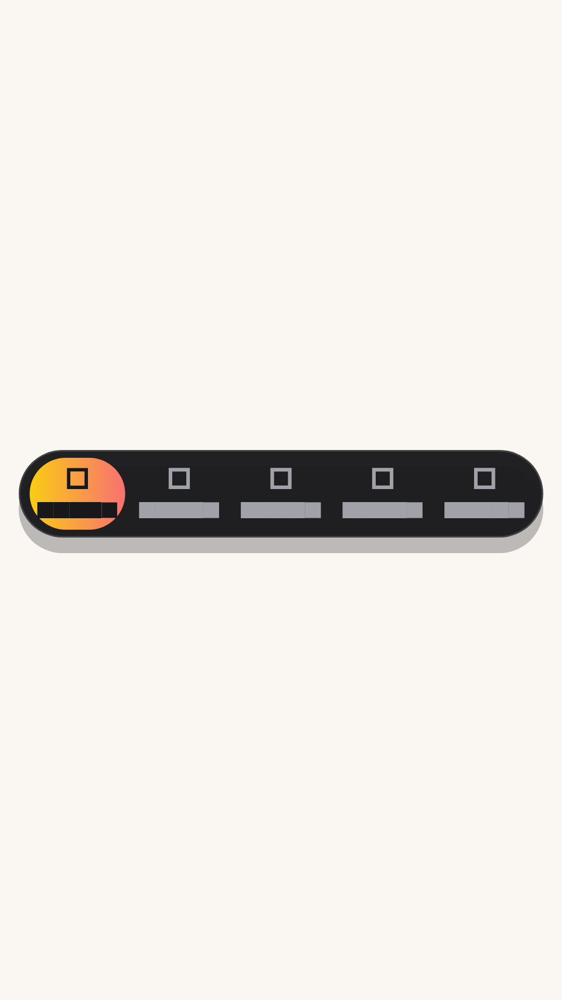
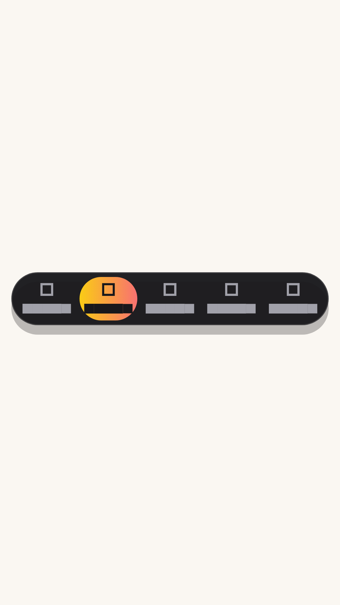
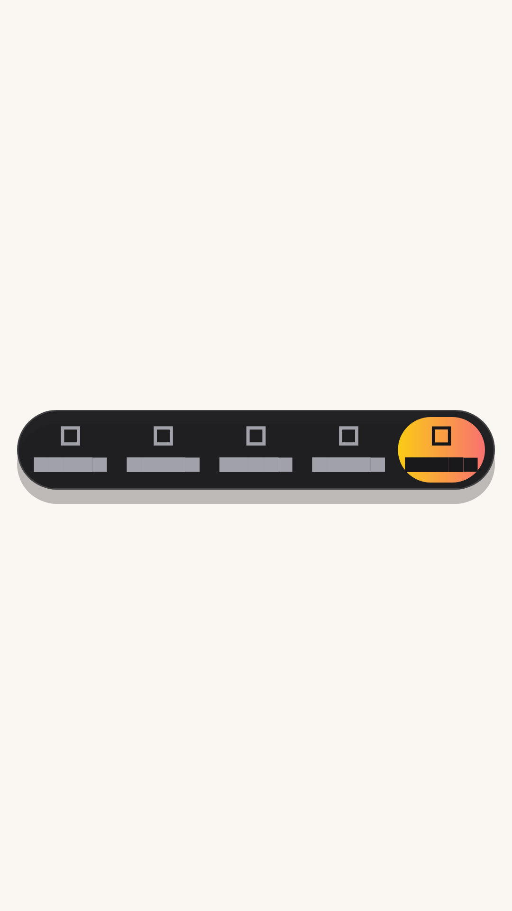
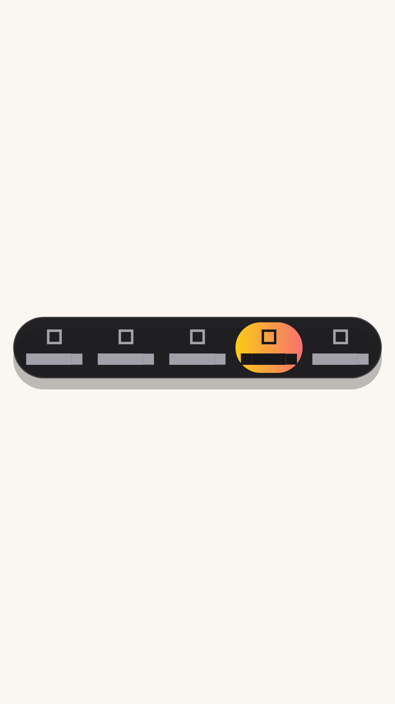

<div align="center">


# Nos Candidats

**Application de campagne municipale 2026 — Aïn El Turck, Oran**

Application officielle de campagne de **Nabil Zenasni**, secrétaire du bureau
communal du **RND** (Rassemblement National Démocratique) à Aïn El Turck.

[](https://github.com/Connacri/rnd/actions/workflows/ci.yml)
[](https://github.com/Connacri/rnd/releases)
[](https://flutter.dev)
[](https://dart.dev)
[](https://developer.android.com)
[](#licence)

[🌐 Application web](https://connacri.github.io/rnd/) ·
[⬇️ Télécharger l'APK](https://github.com/Connacri/rnd/releases/latest/download/rnd-android.apk) ·
[📦 Toutes les releases](https://github.com/Connacri/rnd/releases) ·
[⚙️ CI/CD](https://github.com/Connacri/rnd/actions)

</div>

---

## Table des matières

- [Présentation](#présentation)
- [Captures d'écran](#captures-décran)
- [Fonctionnalités](#fonctionnalités)
- [Stack technique](#stack-technique)
- [Architecture du projet](#architecture-du-projet)
- [Prérequis](#prérequis)
- [Démarrage rapide](#démarrage-rapide)
- [Internationalisation](#internationalisation)
- [Contenu éditable (Supabase)](#contenu-éditable-supabase)
- [Notifications (FCM)](#notifications-fcm)
- [Android](#android)
- [Builds](#builds)
- [CI/CD](#cicd)
- [Signatures Android (SHA)](#signatures-android-sha)
- [Google Play](#google-play)
- [Outils MCP](#outils-mcp)
- [Téléchargements](#téléchargements)
- [Licence et crédits](#licence-et-crédits)

---

## Présentation

**Nos Candidats** est l'application de campagne mobile et web du candidat
**Nabil Zenasni** pour les élections communales de 2026 à Aïn El Turck (Oran,
Algérie).

L'application mobile est écrite en **Flutter** et publiée sur **Android**
(APK/AAB). Le site web (**GitHub Pages**) est l'application **React 19 + Vite**
du dépôt (`index.html` + `src/`), compilée par la CI puis publiée dans
`dist/`.

Le contenu (programme, actualités, événements, chiffres clés) est éditable sans
redéploiement depuis une base **Supabase** ; l'authentification et les
notifications push s'appuient sur **Firebase**.

## Captures d'écran

<div align="center">






</div>

## Fonctionnalités

| Module | Description |
| --- | --- |
| **Accueil** | Présentation du candidat, message audio, chiffres clés du RND, dernières actualités |
| **Candidat** | Biographie, vision et valeurs (éditables depuis Supabase) |
| **Programme** | Piliers thématiques et points détaillés (éditables depuis Supabase) |
| **Adhésion** | Formulaire d'adhésion au mouvement, validation des champs |
| **Événements** | Calendrier des événements de campagne (éditable depuis Supabase) |
| **Authentification** | Email / mot de passe + Google Sign-In (Firebase Auth), mot de passe oublié |
| **Notifications** | Actualités poussées via FCM (topic `news`) + notifications locales |
| **Langues** | Français, Arabe (RTL) et Anglais |
| **Hors ligne** | Repli automatique sur les données statiques si Supabase est injoignable |
| **Design** | Identité visuelle alignée sur le site web (thème clair crème/ambre, ruban tricolore, navigation en pilules, bascule FR/AR/EN) |

## Stack technique

| Domaine | Technologie |
| --- | --- |
| Framework | **Flutter 3.44** / Dart |
| Gestion d'état | `provider` |
| Authentification | **Firebase Auth** (email, Google) |
| Notifications | **Firebase Cloud Messaging** + `flutter_local_notifications` |
| Contenu | **Supabase** (PostgreSQL + RLS) |
| Traductions | `flutter_localizations` + ARB (`fr`, `en`, `ar`) |
| Audio | `audioplayers` |
| Typographie | `google_fonts` |
| Icônes / splash | `flutter_launcher_icons`, `flutter_native_splash` |
| Site web (Pages) | **React 19** + **Vite 6** + **Tailwind CSS 4** (`tsc` en typecheck) |
| CI/CD | **GitHub Actions** (APK + AAB signés, site GitHub Pages, Releases) |

## Architecture du projet

```text
rnd/
├── index.html                      # Point d'entree du site React (Vite)
├── src/                            # Site web React 19 (pages, composants, i18n)
├── public/                         # Assets du site (favicons, images, audio, PWA)
├── package.json                    # Dependances et scripts du site (vite build)
├── vite.config.ts                  # Config Vite (BASE_PATH pour GitHub Pages)
├── android/                        # Projet Android natif (Gradle / Kotlin)
├── ios/                            # Projet iOS (Runner Xcode)
├── assets/
│   ├── audio/                      # Messages audio (fr.mp3, ar.mp3)
│   ├── icons/                      # Icône et splash sources + générés
│   └── images/                     # Visuels et captures d'écran
├── lib/
│   ├── app/                        # MaterialApp, routes, coquille, thème
│   │   ├── app.dart
│   │   ├── app_shell.dart          # En-tête + ruban + navigation (identité du site)
│   │   ├── routes.dart
│   │   └── theme.dart              # Palette claire partagée avec le site (crème/ambre)
│   ├── core/
│   │   ├── constants/              # Constantes applicatives et Supabase
│   │   ├── providers/              # Providers transverses (langue)
│   │   ├── services/               # Notifications, contenus, traductions
│   │   └── utils/                  # Helpers (textes localisés, validateurs)
│   ├── features/                   # Modules fonctionnels autonomes
│   │   ├── auth/                   # Connexion, inscription, modèle utilisateur
│   │   ├── candidate/             # Page candidat
│   │   ├── content/                # Chargement des contenus Supabase
│   │   ├── events/                 # Événements
│   │   ├── home/                   # Page d'accueil
│   │   ├── membership/             # Adhésion
│   │   └── program/                # Programme
│   ├── l10n/                       # Traductions générées + sources ARB
│   ├── widgets/                    # Composants partagés
│   └── main.dart                   # Point d'entrée (Firebase, FCM, providers)
├── test/                           # Tests
├── tool/                           # Scripts utilitaires (assets, fiche Play, notifications)
├── store/play/listings.json        # Fiche Play (nom + descriptions fr/en/ar)
├── store/play/icon-512.png         # Icône de la fiche Play (512x512, générée)
├── web/                            # Coquille web (index.html, manifest PWA)
└── .github/workflows/ci.yml        # Intégration continue
```

Chaque module de `lib/features/` est autonome (`models/`, `providers/`,
`screens/`, `services/`) afin de rester testable et isolé.

## Prérequis

- [Flutter](https://flutter.dev) **3.44.0** (version utilisée en CI)
- Android SDK / JDK 17+ (pour les builds Android)
- Un projet **Firebase** (Auth, FCM) — `google-services.json` non committé
- Un projet **Supabase** (contenu éditable)

## Démarrage rapide

```bash
# 1. Récupérer le projet
git clone https://github.com/Connacri/rnd.git
cd rnd

# 2. Installer les dépendances
flutter pub get

# 3. Créer le fichier de secrets local (jamais committé)
cp .env.example .env
#    renseigner SUPABASE_URL et SUPABASE_ANON_KEY

# 4. Lancer l'application (mode debug)
flutter run --dart-define-from-file=.env
```

Le fichier `.env` n'est **jamais** committé (ni les clés de signature). Toutes
les valeurs sensibles de la CI vivent dans les *GitHub Secrets*.

### Vérifications locales

```bash
dart format --output=none --set-exit-if-changed lib tool
flutter analyze --no-fatal-infos
flutter test
```

## Internationalisation

Les traductions sont dans `lib/l10n/` (`app_fr.arb`, `app_en.arb`,
`app_ar.arb`) et sont générées par `flutter gen-l10n` :

```bash
flutter gen-l10n
```

Le français est la langue de référence et sert de repli
(`fr` → `en` → `ar`). L'arabe active automatiquement le sens de lecture RTL.

## Contenu éditable (Supabase)

Les tables suivantes sont en **lecture publique** (RLS `SELECT`) et sont
éditables directement depuis le dashboard Supabase :

| Table | Description |
| --- | --- |
| `programs` | Piliers du programme (titre, sous-titre, tag) |
| `program_items` | Points détaillés sous chaque pilier |
| `events` | Événements de campagne |
| `candidates` | Candidat / équipe |
| `news` | Actualités (source des notifications FCM) |
| `home_stats` | Chiffres de la page d'accueil |

Les champs textuels localisés utilisent le format JSONB
`{"fr": "...", "en": "...", "ar": "..."}`. Si la langue demandée est absente,
l'application applique un repli sur `fr`.

Si les tables sont vides ou injoignables, l'application utilise les données
statiques embarquées (`lib/core/services/program_data.dart`) et affiche un état
d'erreur avec possibilité de réessayer.

## Notifications (FCM)

- L'application s'abonne au topic `news` au démarrage.
- Les actualités publiées dans Supabase peuvent être poussées :
  - depuis la console Firebase → *Cloud Messaging* → topic `news` ;
  - via le script `dart run tool/notify_news.dart`.
- Le champ `push_sent_at` de la table `news` marque les notifications envoyées.

## Android

| Élément | Valeur |
| --- | --- |
| `applicationId` | `com.rnd.dz` |
| `namespace` | `com.rnd.dz` |
| `minSdk` / `targetSdk` | valeurs Flutter (`flutter.minSdkVersion` / `flutter.targetSdkVersion`) |
| Icône | icône adaptative (`mipmap-anydpi-v26/launcher_icon.xml`) + léguée |
| Splash | `flutter_native_splash` (clair + Android 12+, fond blanc) |
| Signature release | `android/app/build.gradle.kts` → `key.properties` (non committé) |

L'`applicationId` **ne doit pas changer** : il est lié à la fiche Google Play
Console et aux certificats SHA enregistrés dans Firebase.

### Icônes, splash et assets

Les sources vivent dans `assets/icons/` (`icon.png`, `splash.png`) ; toutes les
déclinaisons sont générées par des scripts, jamais éditées à la main :

```bash
dart run tool/generate_assets.dart      # favicons et icônes du site (public/) + icône Play
dart run flutter_launcher_icons         # icônes natives (android, ios, web, windows, macos)
dart run flutter_native_splash:create   # splashes natifs
```

Chaque sortie a un seul producteur : `flutter_launcher_icons` gère `web/` et
`tool/generate_assets.dart` gère `public/` ainsi que l'icône de la fiche Play
(`store/play/icon-512.png`). Le fond des icônes adaptatives, des icônes web et
de l'icône Play reprend le vert du logo (`#026342`) pour éviter toute couture.

### Signature release

La signature de production est réalisée **exclusivement en CI**, à partir de :

```text
ANDROID_KEYSTORE_BASE64     # keystore .jks encodé en base64
ANDROID_KEYSTORE_PASSWORD   # mot de passe du keystore
ANDROID_KEY_ALIAS           # alias de la clé
ANDROID_KEY_PASSWORD        # mot de passe de la clé
```

Le keystore n'est jamais committé (`.gitignore`) :

```bash
# régénérer la valeur du secret à partir du keystore local
base64 -w0 android/app/upload-keystore.jks > upload-keystore-base64.txt
```

En l'absence de ces secrets, le build échoue : l'application ne doit **jamais**
être publiée avec la clé de debug.

#### Vérifier la signature d'un APK

```bash
$ANDROID_HOME/build-tools/<version>/apksigner verify --print-certs app-release.apk
$ANDROID_HOME/build-tools/<version>/apksigner verify --print-certs app-release.apk \
  | grep -i "certificate SHA-256"
```

Vérifier également le `package name` et la `versionName` :

```bash
$ANDROID_HOME/build-tools/<version>/aapt2 dump badging app-release.apk | head -5
```

## Builds

**Aucune build de production n'est produite localement.** Les APK/AAB release
signés sont générés par GitHub Actions ; le site web React est compilé par la
CI puis publié sur GitHub Pages.

En local, uniquement le développement et la validation :

```bash
flutter run                 # debug
flutter build apk --debug   # APK de debug
flutter analyze             # analyse statique
flutter test                # tests

npm ci                      # dependances du site
npm run dev                 # site React en local (http://localhost:3000)
npm run lint                # typecheck TypeScript
```

En CI :

```bash
flutter build apk         --release --build-name=$V --build-number=$N ...
flutter build appbundle   --release --build-name=$V --build-number=$N ...

npm ci
npm run build             # BASE_PATH=/rnd/ → dist/ publie sur GitHub Pages
```

## CI/CD

L'intégralité du pipeline est décrite dans
[`.github/workflows/ci.yml`](.github/workflows/ci.yml).

```text
git push
   │
   ├─ version         → calcule la prochaine vX.Y.Z (tags git) et le
   │                    versionCode Android (MAJEUR*1e6 + MINEUR*1e3 + PATCH)
   │
   ├─ quality         → flutter pub get · dart format · flutter analyze · flutter test
   │
   ├─ build-android   → APK + AAB signés (keystore depuis les secrets)
   │                    vérification signature + package + versionName/versionCode
   ├─ publish-play    → envoi de l'AAB sur Google Play (canal production)
   │                    actif seulement si PLAY_UPLOAD_ENABLED=true
   ├─ play-listing    → alignement de la fiche Play sur store/play/
   │                    (nom, descriptions et icône)
   │                    actif seulement si PLAY_UPLOAD_ENABLED=true
   ├─ build-site      → site React compilé par Vite (BASE_PATH=/rnd/ → dist/)
   │                    typecheck TypeScript puis build de production
   │
   ├─ deploy-pages    → mise en ligne du site (GitHub Pages)
   │
   └─ release         → tag git + GitHub Release
                        (APK, AAB, site ZIP, SHA256SUMS.txt)
```

Chaque artefact de release est accompagné de son empreinte SHA-256 dans
`SHA256SUMS.txt`.

### Secrets GitHub

| Secret | Rôle |
| --- | --- |
| `ANDROID_KEYSTORE_BASE64` | Keystore Android (base64) |
| `ANDROID_KEYSTORE_PASSWORD` | Mot de passe du keystore |
| `ANDROID_KEY_ALIAS` | Alias de la clé de signature |
| `ANDROID_KEY_PASSWORD` | Mot de passe de la clé |
| `GOOGLE_SERVICES_JSON_BASE64` | `google-services.json` (base64) |
| `SUPABASE_URL` | URL du projet Supabase |
| `SUPABASE_ANON_KEY` | Clé publique (anon) Supabase |
| `PLAY_SERVICE_ACCOUNT_JSON` | Clé du compte de service Google Play (JSON) |

### Variables GitHub

| Variable | Valeur | Rôle |
| --- | --- | --- |
| `ANDROID_PACKAGE_NAME` | `com.rnd.dz` | Contrôle de l'`applicationId` en CI |
| `FIREBASE_PROJECT_ID` | `rnd-aet` | Projet Firebase lié |
| `SUPABASE_PROJECT_REF` | `liveclvibiqcpekanfbp` | Référence du projet Supabase |
| `PLAY_UPLOAD_ENABLED` | `true` / `false` | Active l'envoi Play et l'alignement de la fiche |

### Régénérer les secrets base64

```bash
# Keystore de signature
base64 -w0 android/app/upload-keystore.jks

# Configuration Firebase Android
base64 -w0 android/app/google-services.json
```

Sur macOS : `base64 -i <fichier>`.
`GOOGLE_SERVICES_JSON_BASE64` doit correspondre au projet `rnd-aet` et au
package `com.rnd.dz` (le job Android échoue sinon).

> Les secrets ne sont jamais écrits dans le dépôt ni affichés dans les logs :
> ils sont injectés via des fichiers temporaires supprimés après le build.

## Signatures Android (SHA)

Empreintes du certificat de **signature de release** (keystore CI). Elles sont
enregistrées dans Firebase (`rnd-aet`) pour autoriser Google Sign-In sur Android.

| Type | Empreinte |
| --- | --- |
| SHA-1 | `2bdd863ca63eacf24d326e83bd621b70768cca3d` |
| SHA-256 | `0c484bd4d96d6eebc9d2054a3b249a0737e84b06c552012edc9fe8bf2497b484` |

> Certificat : `CN=RNDAET, OU=Dev, O=RNDAET, L=Alger, ST=DZ, C=DZ` (RSA 2048,
> valide jusqu'au 06/12/2053).

Lorsque **Google Play App Signing** est activé, Play re-signe l'application avec
sa propre clé : les empreintes de cette clé doivent également être enregistrées
dans Firebase, sinon Google Sign-In échoue sur les versions distribuées par le
Play Store. La lignée de signature se lit via l'API Play (`generatedApks`,
commande `dart run tool/play_listing.dart signing`) ; elle a été ajoutée à
Firebase `rnd-aet`.

| Certificat | SHA-1 | SHA-256 |
| --- | --- | --- |
| Clé de signature d'application (v3.0, Android ≤ 16) | `4cba7a52aa0d2b77c8531de15237a5a35c745a69` | `b5e1ae3800abdce688dba0e37db5ef3c75d251a97764b30db86bad65bd46502e` |
| v3.2 hybride — classique | `f0f60ca64d8c1f6f78f646417a3f976808bce8c5` | `0ae7cc5ad0db44b29cd7a0a9700ac9e08dcc303124144cc47f0553a5f24a3073` |
| v3.2 hybride — PQC (identité courante sur Android 17+) | `75193fb808826914a307019b875f7bd6bf52e5a0` | `d25cba2c3814bb080d77f03e58a97eecad1c7b58eff6375e89fb8b1ac628483d` |

> Le certificat « source stamp » de Play n'est **pas** enregistré : ce n'est pas
> une clé de signature de l'application.

## Google Play

| Élément | Valeur |
| --- | --- |
| Nom affiché | `Nos Candidats` |
| `applicationId` | `com.rnd.dz` |
| Canal d'envoi | `production` |
| Fichier envoyé | `rnd-android.aab` (AAB signé, produit par la CI) |
| Fiche (source) | `store/play/listings.json` (`fr-FR`, `en-US`, `ar`) |
| Icône de la fiche | `store/play/icon-512.png` (512x512, générée par `tool/generate_assets.dart`) |
| Compte de service | `play-console-mcp@cargolink-23dd3.iam.gserviceaccount.com` |
| Compte développeur | Inturk (`oran.inturk@gmail.com`) |

L'envoi est réalisé par le job `publish-play` (action
`r0adkll/upload-google-play`) après le build Android signé. Il ne s'exécute que
si la variable de dépôt `PLAY_UPLOAD_ENABLED` vaut `true` (c'est le cas sur ce
dépôt). L'application étant en **publication gérée**, Google refuse l'envoi en
revue automatique : l'AAB est déposé en **modification en attente**
(`changesNotSentForReview: true`), à valider depuis la Play Console — comme la
fiche ci-dessous.

Prérequis côté Play Console, dans *Utilisateurs et autorisations* : inviter
l'adresse du compte de service ci-dessus et lui accorder au minimum

- *Mettre les applications à disposition de tous les utilisateurs, exclure des
  appareils et utiliser la signature d'application Play* ;
- *Déployer les applications sur des canaux de test* ;
- *Gérer les canaux de test et modifier les listes de testeurs*.

### Fiche du Play Store

Le nom affiché, les descriptions et l'icône sont versionnés dans `store/play/`
et appliqués via `tool/play_listing.dart` (API Android Publisher, même compte de
service que la CI) :

```bash
dart run tool/play_listing.dart list      # fiche publiée actuelle
dart run tool/play_listing.dart images    # visuels publiés (icône, bannière, captures)
dart run tool/play_listing.dart check     # écart avec store/play/ (exit 1 si écart)
dart run tool/play_listing.dart apply     # applique listings.json (--dry-run pour simuler)
dart run tool/play_listing.dart icon      # téléverse icon-512.png (--dry-run pour simuler)
dart run tool/play_listing.dart signing   # empreintes du certificat Play App Signing
```

L'icône de la fiche (`store/play/icon-512.png`, 512x512) est produite depuis
`assets/icons/icon.png` par le même générateur que les icônes du site :

```bash
dart run tool/generate_assets.dart
```

`icon` est idempotente : elle compare l'empreinte SHA-1 locale à celle publiée
et ne téléverse que si le visuel a changé. `check` vérifie la même empreinte,
donc tout écart entre `store/play/icon-512.png` et la fiche Play est signalé.

Identifiants : `PLAY_SERVICE_ACCOUNT_JSON` (JSON en ligne, utilisé par la CI) ou
`GOOGLE_APPLICATION_CREDENTIALS` (chemin du fichier, en local).

> Le **nom** d'une application Play ne peut être modifié qu'un nombre limité de
> fois et repasse par une revue Google. Lorsque l'envoi automatique en revue est
> refusé par Google, l'outil enregistre la fiche en **modifications en attente**
> (paramètre `changesNotSentForReview=true`) : il reste à les envoyer en revue
> depuis la Play Console. Les descriptions ne sont pas soumises à cette limite.

## Outils MCP

Le dépôt déclare ses serveurs MCP dans `opencode.json` (racine) :

| Serveur | Transport | Usage |
| --- | --- | --- |
| `supabase` | distant (`mcp.supabase.com`) | Base, migrations, branches, edge functions |
| `firebase` | local (`firebase-tools mcp`) | Projet, applications, SHA, Firestore |
| `google-play` | local (`google-play-mcp`) | Fiche, canaux, AAB, vitals |
| `render` | distant (`mcp.render.com`) | Services, Blueprints, déploiements |

Aucun secret ni chemin absolu n'est stocké dans `opencode.json` : les
identifiants passent par des variables d'environnement lues à la connexion —
`GOOGLE_APPLICATION_CREDENTIALS` (fichier du compte de service Play) et
`RENDER_API_KEY` (clé d'API Render) — elles-mêmes définies dans la
configuration locale de l'outil et dans les *GitHub Secrets*.

## Téléchargements

| Plateforme | Fichier |
| --- | --- |
| **Android (APK signé)** | [⬇️ rnd-android.apk](https://github.com/Connacri/rnd/releases/latest/download/rnd-android.apk) |
| **Android App Bundle** | [rnd-android.aab](https://github.com/Connacri/rnd/releases/latest/download/rnd-android.aab) |
| **Site web (React)** | [🌐 connacri.github.io/rnd](https://connacri.github.io/rnd/) |

Toutes les versions sont listées sur la page
**[Releases](https://github.com/Connacri/rnd/releases)** ; le CI est visible sur
**[Actions](https://github.com/Connacri/rnd/actions)**.

## Licence et crédits

Projet privé — RND (Rassemblement National Démocratique) — Aïn El Turck, Oran.

Développé par **FORSLOG LTD** · Réalisé par **Ramzy Guedouar** · Contact :
**0696 41 09 53**
